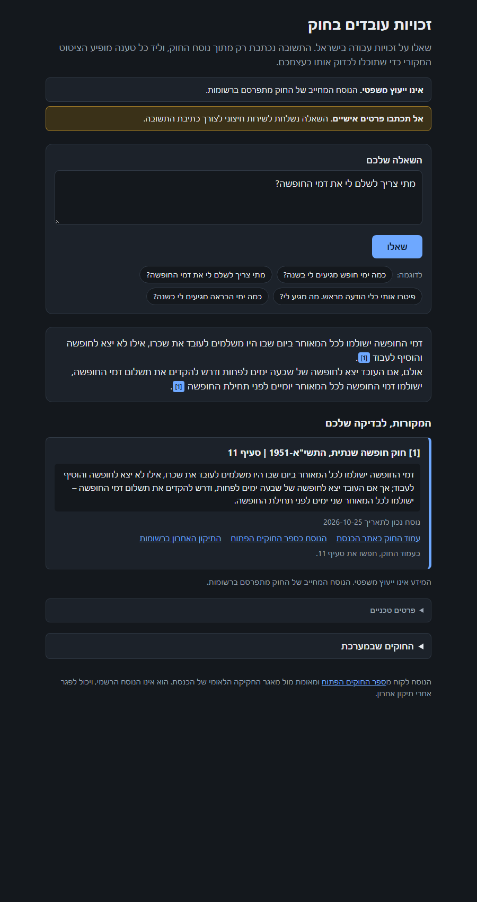
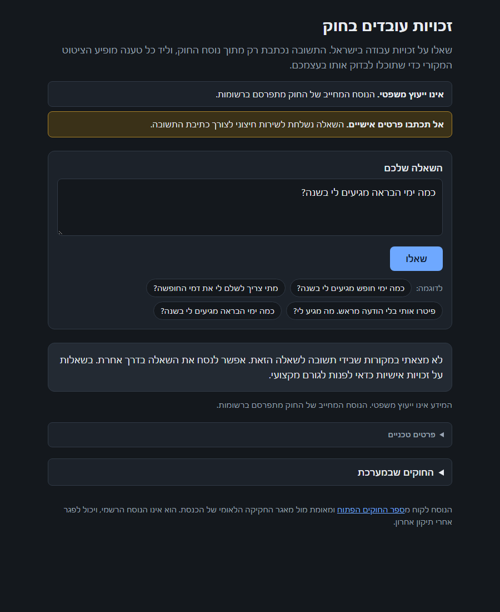

# labor-rights-rag-py

Answers a citizen's questions about employment rights in Israel, in Hebrew, from the text
of 20 labor laws. Every answer cites the sections it used and comes with a **verification
card** built in code from the database (never by the model): the law, the section, the
literal quote, the date of the text, and a link to the law in the Knesset's national
legislation database.

> **Not legal advice.** The text comes from a volunteer-edited wiki, not from the official
> gazette (Reshumot), and can lag behind the latest amendment. The system says so in every
> answer and refuses when it has no source.

The retrieval is written by hand (no LangChain, LlamaIndex or Haystack) and measured on a
frozen set of 56 hand-written questions.

<p>
  
  
</p>

## Run it

```
docker compose up -d --wait        # Postgres, migrations, the application
docker compose run --rm ingest     # once: fetch the 20 laws and index them
# open http://localhost:8002
```

The first start downloads the embedding model (BGE-M3, about 2 GB) into a volume. The
first `ingest` embeds about 900 chunks on the CPU and takes around half an hour; running it
again changes nothing unless a law changed.

Answers are fake until a model is configured. Copy `.env.example` to `.env` and set
`ANSWERER` (`claude`, or `chat` for any OpenAI-compatible service). Compose reads `.env`
at run time and never copies it into the image.

For development: `docker compose up -d --wait postgres`, `uv sync --extra embeddings`,
`uv run alembic upgrade head`, `uv run pytest`, then
`uv run uvicorn labor_rights_rag.main:app --port 8002`.

## How it works

```
corpus.toml ─► Fetcher: Wikisource API (revid, wikitext) + Knesset OData (validity, last publication)
            ─► Parser: wikitext ─► sections + amendment tags ─► currency check
            ─► Chunker (one section = one chunk; long ones split by structure)
            ─► Embedder (BGE-M3) ─► Postgres + pgvector: laws, chunks

question ─► Embedder ─► vector search (exact, cosine, top-k)
         ─► refuse if the closest chunk is too far (before any model call)
         ─► prompt: numbered sources as data only ─► model ─► answer with [n] citations
         ─► checks: every cited number exists ─► verification card from the database
```

| Part | Choice |
|---|---|
| API | FastAPI: `GET /laws`, `GET /search`, `POST /ask`, `GET /health`, and a small chat page at `/` |
| Storage | PostgreSQL 17 with pgvector (SQLAlchemy 2 async, Alembic) |
| Embeddings | BGE-M3 (1024 dimensions) behind an `Embedder` interface; a hash-based fake for tests and CI |
| Retrieval | vector, Postgres full-text on normalized Hebrew, a hand-written BM25, and RRF fusion of them |
| Answers | an `Answerer` interface: Claude (Anthropic SDK), any OpenAI-compatible service, or a fake |
| Tooling | Python 3.12, uv, ruff, mypy (strict), pytest (269 tests), GitHub Actions with a real pgvector |

## What was measured

56 questions about Israeli labor law in a citizen's words, written before looking at any
result and frozen by a hash that a test checks ([eval/README.md](eval/README.md)). They are
split into 39 `dev` questions, used for tuning, and 17 `test` questions, **not yet run**. The
numbers below are `dev` only, over the 32 questions the corpus can answer.

**Retrieval** (share of questions with an expected section among the first k results):

| Mode | Hit@1 | Hit@3 | Hit@5 | MRR |
|---|---|---|---|---|
| vector (the default) | 62% | 81% | 84% | 0.716 |
| text (Postgres full-text) | 9% | 22% | 34% | 0.186 |
| BM25 (hand-written) | 25% | 47% | 59% | 0.374 |
| hybrid, RRF of vector and Postgres text | 44% | 66% | 75% | 0.564 |
| hybrid, RRF of vector and BM25 | 56% | 75% | 84% | 0.684 |

**Answers** (vector search, one free model, `gemini-3.5-flash-lite`; two runs of the same
questions with nothing changed, because the model is not deterministic):

| Measure | Run 1 | Run 2 |
|---|---|---|
| Answerable questions answered | 24 of 32 | 26 of 32 |
| Answers with every expected fact | 23 of 32 | 25 of 32 |
| Unanswerable questions refused | 7 of 7 | 7 of 7 |
| Unanswerable questions answered anyway | 0 | 0 |
| Mean seconds per question | 1.3 | 1.5 |

Read these as a range of about two questions, not as exact figures. A manual read of ten
answers is described below. Two comparisons from
the plan are **not done yet**: the same questions to the model with no retrieval, and with
all the laws in the prompt. The test split has not been run, and Claude has not been called.

## What failed

- **Hybrid search did not beat plain vector search.** It was the plan, and it was the
  reason for writing BM25 by hand. After a sweep of the RRF constant, seven more variants
  were declared before the runs, with the rule that a variant counts only if it finds at
  least two more questions than vector search without a worse MRR. None did. The default is vector search; the other modes stay
  as options ([ADR-0010](docs/adr/0010-retrieval-mode.md)).
- **Most misses are vocabulary gaps, not ranking errors.** Four of the five vector misses
  ask about late wages, deductions, limitation periods or "which court", where the law
  uses other words (for example "הלנת שכר" or "בית דין"). Neither search finds them.
- **The approximate index returned too few rows.** CI failed on a run that passed locally:
  an HNSW index on a small table or after many deletes returned one row where two were
  expected. Queries are now exact by default, which is milliseconds for 920 vectors
  ([ADR-0011](docs/adr/0011-exact-vector-scan.md)).
- **Faithful is not the same as helpful.** Ten answers were read by hand against the full
  text of their sources ([review](eval/results/2026-10-27-dev-faithfulness-review.md)).
  None stated an invented fact. Two were still misleading: a question about unpaid wages was
  answered with the limitation period of late-payment compensation, which the law says is
  "as distinct from wages", and a question about a collapsing company was answered with
  the liability of a new employer, in a section that does not apply to bankruptcy. The
  automatic fact check marked both correct, because it looks for terms, not for relevance.
- **Five laws are marked `ahead`.** Their text in the Open Law Book shows an amendment
  that the Knesset registry does not yet list. The likely reason is a lag in the registry,
  but that is not verified; the card shows a yellow note.
- **A model that never refuses is worse than one that sometimes does.** The system refuses
  in two layers: a similarity threshold before the model, and the model itself. On the dev
  questions no unanswerable question got an answer, at the cost of refusing some that
  could have been answered ([ADR-0009](docs/adr/0009-refusal-and-verification.md)).

## Decisions

| Decision | Record |
|---|---|
| Corpus and allowed sources | [ADR-0002](docs/adr/0002-corpus-and-sources.md) |
| Law versions, currency check, verification card | [ADR-0003](docs/adr/0003-versioning-and-verification.md) |
| Chunking by section, long sections split by structure | [ADR-0004](docs/adr/0004-chunking.md) |
| BGE-M3 for embeddings | [ADR-0005](docs/adr/0005-embedding-model.md) |
| Hebrew text search | [ADR-0006](docs/adr/0006-hebrew-text-search.md) |
| RRF fusion | [ADR-0007](docs/adr/0007-hybrid-fusion.md) |
| Answer generation and the prompt | [ADR-0008](docs/adr/0008-answer-generation.md) |
| When to refuse, and what is checked | [ADR-0009](docs/adr/0009-refusal-and-verification.md) |
| Vector search as the default | [ADR-0010](docs/adr/0010-retrieval-mode.md) |
| Exact vector scan | [ADR-0011](docs/adr/0011-exact-vector-scan.md) |
| Redis removed | [ADR-0012](docs/adr/0012-remove-redis.md) |

## Known limits

- **Only 20 laws.** Secondary legislation (regulations, extension orders), collective
  agreements and case law are out of scope. Some rights, such as recovery pay, come from
  extension orders and the system refuses to answer about them.
- **The text is not official.** It is the Open Law Book on Hebrew Wikisource, which anyone
  can edit and which can lag behind an amendment. The prompt treats it as data, never as
  instructions, and the card says when it could not be checked against the Knesset.
- **Not legal advice.** The binding text is published in Reshumot.
- **Small evaluation, one free model.** 32 answerable dev questions and one model that is
  not deterministic. The numbers show direction, not precision.
- **Privacy.** With a free hosted model the question is sent to an outside service, which
  may keep and review it. The page warns users not to write personal details. This setup
  is for a demo, not for real users.

## Sources and license

The law text comes from the [Open Law Book](https://he.wikisource.org/wiki/%D7%A1%D7%A4%D7%A8_%D7%94%D7%97%D7%95%D7%A7%D7%99%D7%9D_%D7%94%D7%A4%D7%AA%D7%95%D7%97)
on Hebrew Wikisource, available under
[CC BY-SA 4.0](https://creativecommons.org/licenses/by-sa/4.0/), and is checked against the
Knesset's OData service. Quotes in the answers, the test fixtures and the evaluation
results keep that license; the fixtures are listed in
[tests/fixtures/wikisource/ATTRIBUTION.md](tests/fixtures/wikisource/ATTRIBUTION.md).
